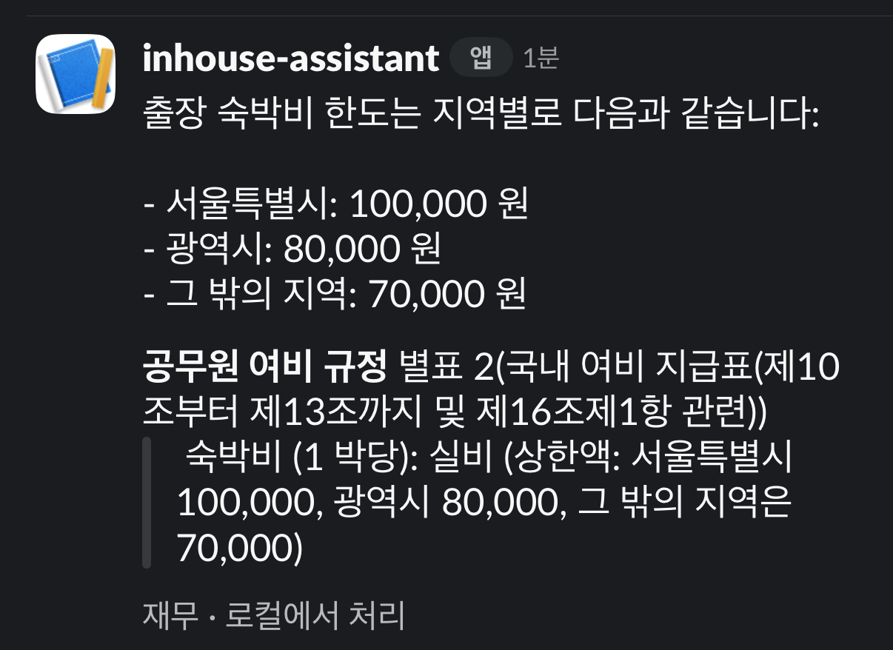
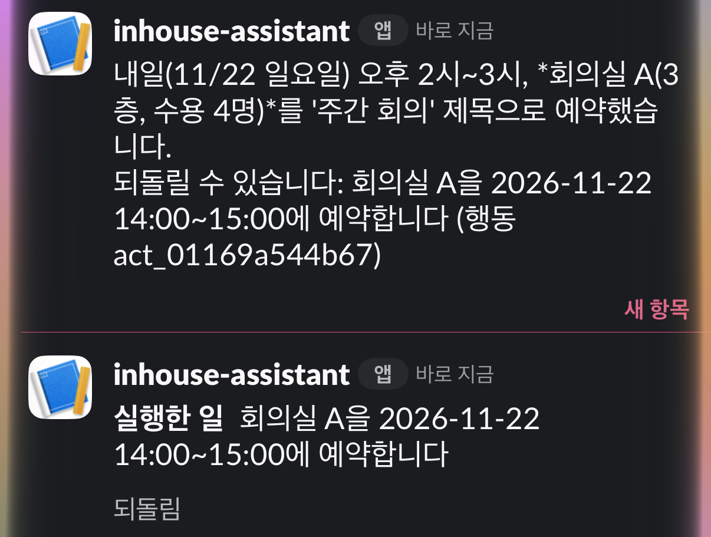
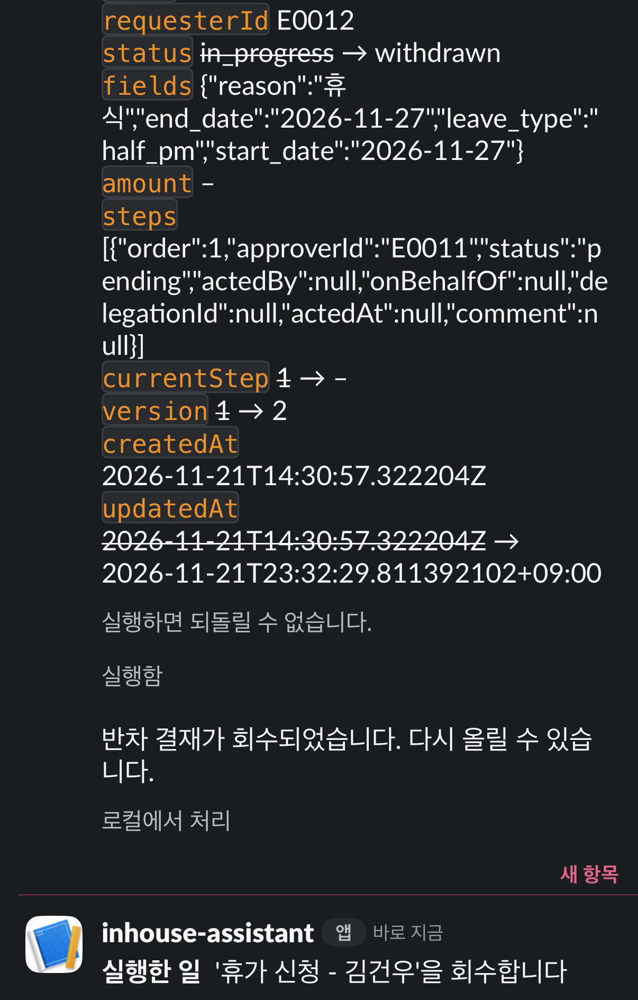
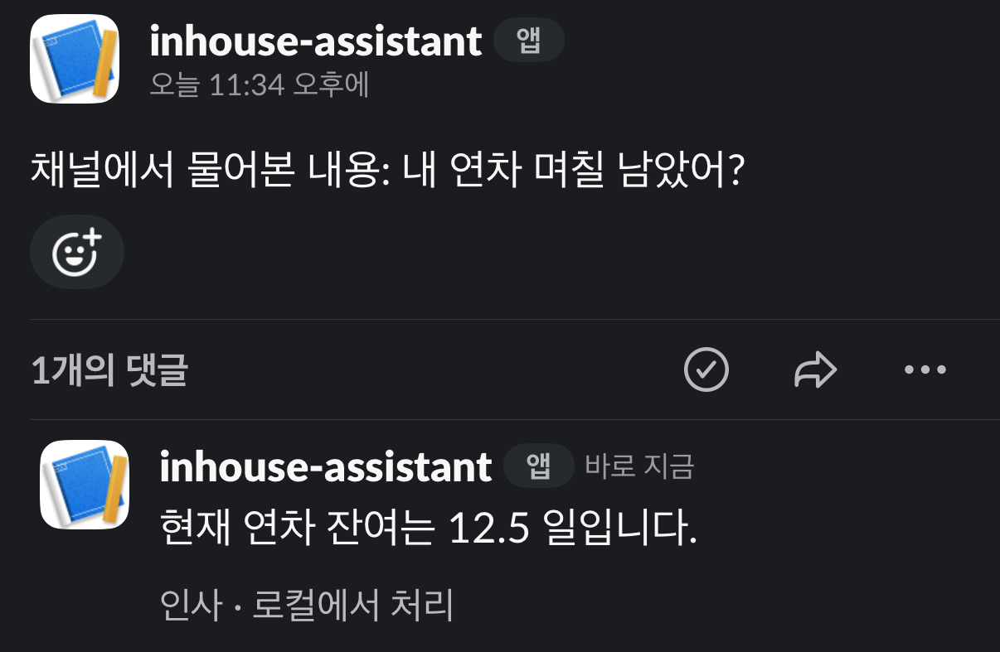

# 슬랙 브리지

직원이 슬랙 DM이나 채널 멘션으로 사내 AI 비서와 대화하게 하는 브리지입니다. gateway의 클라이언트로, 웹 화면과 같은 gateway API(대화, 실행 승인, 되돌리기, 알림)를 부릅니다. TypeScript, [Bolt for JavaScript](https://github.com/slackapi/bolt-js)(MIT) Socket Mode라 공개 URL이 필요 없습니다.

## 하는 일

| 슬랙에서 | 브리지가 하는 일 |
|---|---|
| 봇에게 DM | 슬랙 사용자를 gateway `/auth/slack`으로 직원 토큰과 바꾸고, 대화를 만들어 메시지를 보낸 뒤 답을 그 스레드에 올립니다. 같은 스레드는 같은 대화입니다 |
| 채널에서 `@봇` 멘션 | 답에 개인 정보(연차 잔여, 결재 내용)가 들어갈 수 있어, 채널 스레드에는 "DM으로 이어 갑니다"만 남기고 요청자와의 DM에서 대화합니다 |
| 답에 근거가 있으면 | 문서 제목·조문과 인용문을 인용 블록으로 붙이고, 확인 안 된 인용은 표시합니다. 로컬 모델로 처리했으면 "로컬에서 처리"를 밝힙니다 |
| 되돌릴 수 없는 실행(`approval_required`) | 실행 미리보기 카드(바뀌는 값 전 → 후, 위험 등급)와 실행·취소 버튼. 누른 사람이 요청자 본인일 때만 gateway에 결정을 보냅니다 |
| 실행한 일(`action`) | 요약과, 되돌릴 수 있으면 되돌리기 버튼(요청자 본인만). 같은 행동은 같은 `Idempotency-Key`로 보내 두 번 눌러도 한 번만 되돌립니다 |
| 팀장 결재 차례 등 erp 알림 | 브리지에 한 번이라도 말을 건 직원에게 새 알림을 DM으로 보냅니다. 승인·반려는 사람 전용 기능이라 슬랙 버튼을 두지 않고 웹 승인함 링크만 붙입니다 |

- 봇 메시지와 편집·삭제(하위 형식이 있는 메시지), 같은 이벤트의 재전달은 무시합니다.
- 한 사람은 한 번에 한 메시지만 처리합니다(스레드가 달라도). 앞 답이 오기 전에 보내면 그 사람에게만 안내합니다.
- 연결된 직원 계정이 없는 슬랙 사용자에게는 안내만 하고 대화를 만들지 않습니다.
- 다른 사람이 남의 스레드에 쓰면 그 사람에게만 보이는 안내를 남기고 대화를 잇지 않습니다.
- 사용자·모델 글의 `&`, `<`, `>`는 블록과 대체 text 모두에서 바꿔 올리고 `verbatim`으로 둬, 글 안의 `<!channel>`이나 URL이 멘션·링크로 읽히지 않게 합니다. 멘션은 맨 앞의 봇 멘션만 지웁니다.
- gateway 오류는 4xx면 problem `title`만, 5xx·연결 실패면 고정 문구만 슬랙에 올립니다. 원문(detail)은 로그에만 남깁니다.
- 실행 버튼을 누르면 카드를 "처리하는 중"으로 바꾸고, `approval_decided`를 받아야 실행함·취소함으로 확정합니다. 4xx면 "더 결정할 수 없음", 5xx·끊김이면 버튼을 되살려 다시 누를 수 있게 합니다.
- 직원 토큰은 최대 15분(JWT `exp` 1분 전이 더 이르면 그때)까지 다시 써 `/auth/slack` 호출을 줄이고, 401이면 한 번 다시 로그인합니다. 매핑 없는 사용자는 5분 동안 다시 묻지 않습니다.
- `/auth/slack`이 횟수 제한(429)을 넘으면 `Retry-After`만큼(30초까지) 기다렸다 한 번 다시 부르고, 그래도 막히면 잠시 뒤 다시 하라고 안내합니다. 비밀값이 틀리거나(401) gateway에 슬랙 로그인이 설정되지 않았으면(404) 설정 문제라고만 알리고 원문은 로그에 남깁니다.
- 긴 답은 3000자 안쪽 section으로 나누고, 블록이 50개를 넘으면 줄였다고 밝힙니다.

## 구조

| 파일 | 내용 |
|---|---|
| `src/bridge.ts` | 핵심. 스레드 ↔ 대화, 채널 멘션의 DM 전환, 토큰 캐시, 카드 소유자 확인, 알림 DM. Bolt와 gateway를 인터페이스(`Slack`, `Gateway`)로만 봐서 가짜로 시험합니다 |
| `src/gateway.ts` | gateway HTTP 클라이언트. SSE 스트림을 `ChatEvent`로 읽고, 오류는 problem+json `title`로 바꿉니다 |
| `src/render.ts` | `ChatEvent` 묶음 → Block Kit 메시지(답, 근거, 차단·오류, 미리보기 카드, 행동 카드, 알림) |
| `src/slack-app.ts` | Bolt 앱(Socket Mode)과 이벤트·버튼 연결 |
| `src/sse.ts` | `text/event-stream` 읽기(`web/src/chat/sse.ts`와 같은 규칙) |
| `src/schema.d.ts` | `contracts/openapi/gateway.yaml`에서 만든 타입(`npm run gen:api`) |

상태(스레드 ↔ 대화, 카드)는 메모리에만 두고, 24시간 지난 스레드·되돌리기 카드와 만료된 실행 승인은 지웁니다. 브리지를 다시 시작하면 앞 카드의 버튼은 안내만 하고, 새 스레드로 다시 시작합니다. 결재 알림도 다시 시작한 뒤 직원이 다시 말을 건 때부터 보냅니다(그 사이 알림은 웹 승인함에서 봅니다).

## 슬랙 앱 설정

- Socket Mode 켜기, App-Level Token(`connections:write`) → `SLACK_APP_TOKEN`
- Bot Token Scopes: `app_mentions:read`, `chat:write`, `im:history`, `im:read`, `im:write` → `SLACK_BOT_TOKEN`
- Event Subscriptions(봇): `app_mention`, `message.im`
- Interactivity 켜기(Socket Mode라 URL 없음)
- App Home의 Messages 탭에서 DM 보내기 허용

## 실행

환경 변수는 저장소 `.env`에서 읽습니다. 토큰과 비밀값은 출력하거나 커밋하지 않습니다.

| 변수 | 내용 |
|---|---|
| `SLACK_APP_TOKEN`, `SLACK_BOT_TOKEN` | 위 슬랙 앱의 토큰 |
| `SLACK_BRIDGE_SECRET` | gateway `/auth/slack`이 브리지를 확인하는 비밀값(gateway와 같은 값) |
| `GATEWAY_URL` | 기본 `http://localhost:${PORT_GATEWAY}/api` |
| `WEB_URL` | 알림의 승인함 링크. 기본 `http://localhost:${PORT_WEB}` |
| `SLACK_NOTIFY_INTERVAL_MS` | 알림 확인 주기. 기본 60000, 최소 10000 |

```bash
cd channels/slack
npm ci
npm test            # 시험(가짜 gateway·슬랙)
npm run lint       # 타입 검사
source ../../scripts/env.sh 6 && npm run dev   # 빌드 후 ../../.env를 읽어 실행
```

## 지금 상태

- gateway `/auth/slack`(#273)의 계약(헤더 `X-Slack-Bridge-Secret`, 본문 `{"slackUserId"}`, 응답 `LoginResponse`, 401·403·404·429)대로 부릅니다.
- 2026-11-21 실제 워크스페이스(봇 `inhouse-assistant`)에서 휴대폰 슬랙으로 확인했습니다. 대상 스택은 `--profile full --profile slack`, 매핑은 재무팀 직원 `E0012`(팀장 알림은 `E0011`)입니다.
- compose 서비스(`--profile slack`)와 CI job은 루트 파일이라 프로젝트 리드가 넣습니다. 이미지는 `channels/slack/Dockerfile`입니다.

## 실제 슬랙 화면(2026-11-21)

휴대폰 화면을 찍어 사용자 이름과 상태 표시줄을 잘라 냈습니다.

| 규정 질문: 근거 인용과 로컬 처리 | 회의실 예약: 실행한 일 카드 → 되돌림 |
|---|---|
|  |  |

| 결재 회수: 미리보기 카드(되돌릴 수 없음) → 실행함 | 채널 멘션 → DM으로 이어 간 답 |
|---|---|
|  |  |

| 팀장 결재 알림 DM(승인·반려는 웹 승인함 링크) |
|---|
|  |

- 결재 회수 카드는 문서 전체(바뀌지 않은 필드 포함)를 보였습니다. 이 확인 뒤 바꾸기는 달라진 필드만 보이고 긴 값은 줄이도록 고쳤습니다.
- 회의실 예약 답의 굵게가 `*회의실 A(…)*를`처럼 별표째 보였습니다. 슬랙은 굵게 기호 바로 뒤에 글자가 붙으면 굵게로 그리지 않아, 이 확인 뒤 앞뒤에 폭 없는 공백을 넣도록 고쳤습니다.
- 사용자가 굵게·코드 서식으로 보낸 글이 `*…*`·`` `…` ``째 넘어가 날짜 값에 별표가 섞였습니다. 서식 기호·링크·이스케이프를 일반 글로 바꿔 보내도록 고쳤습니다.
- 경비 정산은 확인하지 못했습니다. agent가 선택 항목(사업자 번호)과 상대 날짜("어제")를 되묻고, 값을 다 준 뒤에도 `expense_request`가 MCP 입력 검증에 막혔습니다(agent 이슈). 대화가 길어진 턴에서는 로컬 모델 60초 시간 제한(504)이 났습니다.

## 라이선스 표기

- @slack/bolt: MIT
