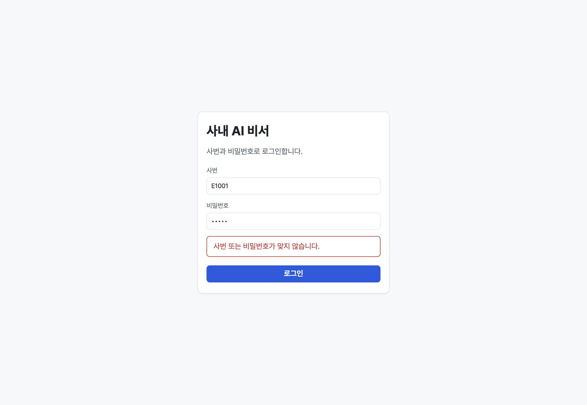
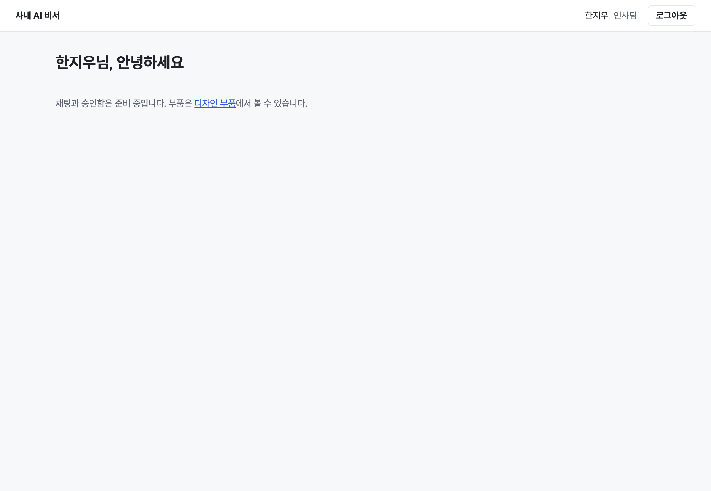
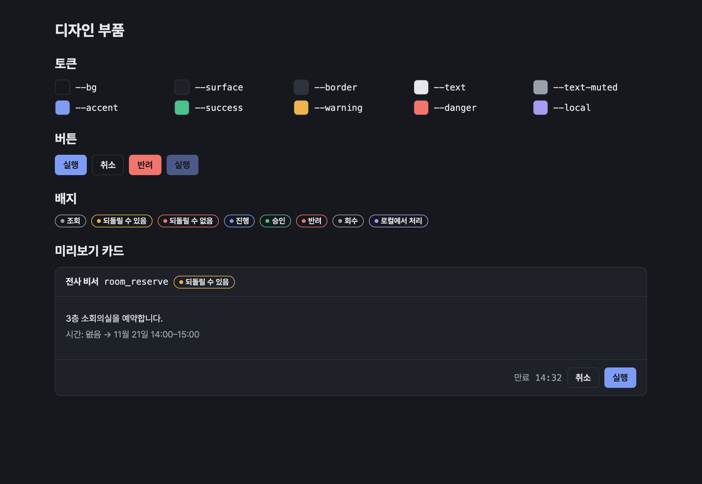

# web

직원 채팅과 팀장 승인함 화면입니다. React, TypeScript, Vite로 만들고, gateway(`contracts/openapi/gateway.yaml`)만 부릅니다. 디자인 기준은 `DESIGN.md`입니다.

## 실행

```bash
npm ci
npm run dev:mock     # gateway 계약 모의 서버(MSW)로 실행합니다. 사번 E1001 또는 E2001, 비밀번호 demo
npm run dev          # 실제 gateway에 붙입니다. /api를 GATEWAY_URL(기본 http://localhost:$PORT_GATEWAY)로 넘깁니다
```

포트는 `docs/ports.md`를 따릅니다. 저장소 루트에서 `source scripts/env.sh 6`을 하면 web은 8600, gateway는 8610입니다.

## 검사

```bash
npm run lint     # oxlint
npm test         # vitest + Testing Library, 요청은 MSW 모의 서버가 받습니다
npm run build    # tsc -b와 vite build
npm run gen:api  # 계약이 바뀌면 src/api/schema.d.ts를 다시 만듭니다(openapi-typescript)
```

## 구조

| 경로 | 내용 |
|---|---|
| `src/api/schema.d.ts` | gateway 계약에서 만든 타입(생성 파일) |
| `src/api/client.ts` | openapi-fetch 클라이언트. 직원 JWT를 붙이고 401이면 로그아웃합니다 |
| `src/auth/` | 로그인 상태(토큰은 sessionStorage) |
| `src/styles/tokens.css` | DESIGN.md 토큰(라이트·다크) |
| `src/components/` | 기본 부품(버튼, 배지, 카드) |
| `src/pages/` | 로그인, 홈, 디자인 부품(`/design`) |
| `src/mocks/` | gateway 계약 모의 서버(MSW)와 지어낸 직원 데이터 |
| `Dockerfile`, `nginx/` | 정적 파일과 `/api` 프록시, `GET /health` |

## 대비

`src/styles/contrast.test.ts`가 토큰 쌍의 대비를 WCAG 식으로 계산합니다. `--success`(흰 바탕 4.3:1)와 `--warning`(4.2:1)은 글자색으로 쓰면 본문 기준 4.5:1에 못 미쳐, 배지는 글자를 `--text`로 두고 상태색을 테두리와 점(3:1 기준)에만 씁니다.

## 실행 이미지

```bash
docker build -t iaa-web .
docker run -p 8600:80 -e GATEWAY_URL=http://host.docker.internal:8610 iaa-web
```

## 화면

모의 서버로 실행해 찍은 화면입니다.

| 로그인 오류 | 홈 |
|---|---|
|  |  |

| 디자인 부품(라이트) | 디자인 부품(다크) |
|---|---|
|  |  |

## 라이선스 표기

- Pretendard: SIL Open Font License 1.1
- MSW, openapi-typescript, openapi-fetch, React, React Router, Vite: MIT
